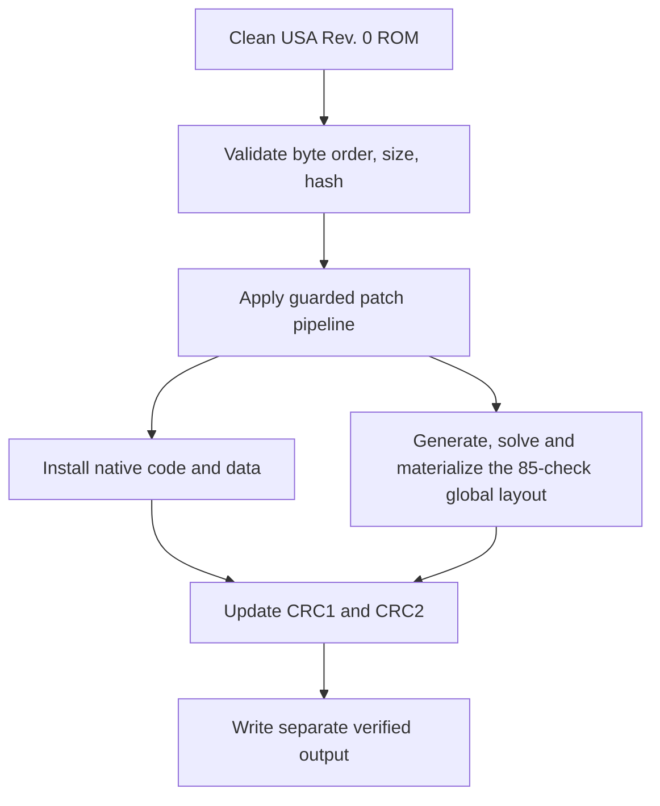

# Architecture overview

## Product boundary

MKMSZR is an offline patch generator. The browser and CLI collect configuration and call the same Python core; neither uploads nor bundles a ROM. The output is a full patched ROM with corrected header checksums.

## Static patch layer

Patch modules own small, guarded edits: title-menu routing, arena-bound changes, file-table registration, hooks, inventory routines, UI wrapper, text, flow branches, and optional palette words. `RomImage` tracks changed spans and raises on an unexpected source byte. The product assumes big-endian words throughout.

## Native runtime layer

The guarded arena-start constructions move the original floor from `0x801AF420` to `0x801B3420`, reserving exactly 16 KiB:

| Range | Purpose |
|---|---|
| `0x801AF420..0x801AF7CF` | 0x3B0-byte Runtime V2 code region |
| `0x801AF7D0..0x801AF81F` | 0x50-byte Runtime V2 persistent state |
| `0x801AF820..0x801B341F` | 15 KiB build-time expansion pool, sub-allocated to production modules carried in shared file `0x1A` (see [Memory and allocation map](Memory-and-Allocation-Map)) |

File ID `0x1B` in the global file table describes a payload stored at ROM `0x00F10000`. The synchronous raw-file loader `0x80065D64` loads it to uncached `0xA01AF420`. A bootstrap stub at `0x8009A184` is called from `0x800663E0`. See [Core runtime and address database](Core-Runtime-and-Address-Database).

The expansion pool is allocated only at ROM-build time. It does not replace the game's dynamic arena allocator, and unused capacity remains reserved rather than becoming an implicit cave. Production modules in the pool (TURN/modern controls, Temple special check, key-to-stage table, lifecycle, Toasty, Power Upgrade flash, global materializer, Inventory HUD, menu switch and legend) travel in shared file `0x1A`, which is raw-loaded at the stage-init bootstrap without cache maintenance; they execute and keep state through uncached KSEG1 aliases. The exact owners and the two reviewed cached code entries (with the invariant that keeps them safe) are in the [Memory and allocation map](Memory-and-Allocation-Map).

## Pickup layer

Production builds generate one **global 85-check layout**: the 84 ordinary `0x30`-byte pickup records across the eight main stages plus the scripted Temple special check (logical Map `0x0D` is excluded). Each retry attempt is a deterministic seeded permutation, validated by a fixed-point reachability solver under **All 85 available** (default) or **Game beatable**, with a 10,000-attempt ceiling. Destination materialization keeps each destination's location, checkpoint, activation and persistence behavior while installing the assigned reward and the resources it needs; generated output is 32 MiB with eight explicit 1 MiB stage-resource slots. See [Global item materialization and solvability](Global-Item-Materialization-and-Solvability).

With **Powers as pickups** ON (default), nine Herbs rewards are converted to synthetic Power Upgrade rewards before the shuffle; acquiring one advances to the next native XP threshold and performs the native tier evaluation. OFF keeps stock earned XP. **Required powers** independently sets the Fortress XP gate.

The earlier stage-local shuffle (identity slice `+0x10..+0x2B` within each stage, with the `MKMSZR:PROGRESSION:HERBS:V1` callback-replacement namespace) remains in code for builds without a global plan; production `patch_rom` always builds the global plan.

## Persistence and inventory layer

The runtime V2 state header owns one bit per ordinary pickup, grouped by native stage, plus separate progression count/XP words at `+0x40/+0x44`. A pickup-capture hook observes the manager ordinal and sets the corresponding bit; a restore hook reapplies flags when the stage manager reconstructs records. Fire uses an explicit 19-ordinal-to-16-bit translation because three manager entries are special type-4 records.

The stock ten-slot inventory remains the live gameplay window. Four ten-word backing boxes at `0x800A6048..0x800A60E7` are authoritative. Switching copies to/from the live window and masks keys from other stages as inert Glass (`0x08`) without destroying their backing values; the mask rule reads a key-to-stage table in MKMSZR-owned memory. The production Inventory HUD shows the true backing identity, so a masked key looks like the real item and is only inert when used.

## Presentation layer

Static outfit modes transform only Sub-Zero clothing palette indices `0x21..0x3F` in the guarded source TLUT. The `rainbow` product mode uses the Runtime-confirmed frame-setup boundary and compact-tail resource path: retail file `0x87` stays in place, all 15 stock Sub-Zero loads allocate an extra `0x2000` bytes, and raw file `0x92` loads the 64-palette BGR555 bank into that tail. A bounded helper at runtime offset `+0x2E0` cycles the actor through those palettes using the native allocation/release path. Compact-tail v01 was Runtime-confirmed across all eight safe stages.

The box indicator hooks an existing HUD submission, executes the displaced call, rewrites the digit in `BOX 1 OF 4`, and sends native text through `0x80073E74`. Boot branding rewrites only guarded legal-screen string storage and pointers; the following two fixed logo presentations are skipped with a separate branch.

## Boundaries not yet crossed

- The global item pool is production beta (85 checks); representative full-seed/all-tier runtime coverage remains pending.
- Enemy randomization is a product option (browser default ON; CLI `--enemy-randomization`) driven by the deterministic 104-record planner/materializer and fail-closed to registered profiles; see [Web patcher and product](Web-Patcher-and-Product) for its remaining gates.
- XP progression is production beta: Diagnostic B is runtime-confirmed through XP 258, Temple -> Wind, and title -> Fire; a full nine-tier run remains pending.
- No finished Reverse Elbow; v6 established a stable lifecycle, while v8 still has movement and interaction defects.
- PS1 findings guide comparison but do not share N64 addresses or binaries.
